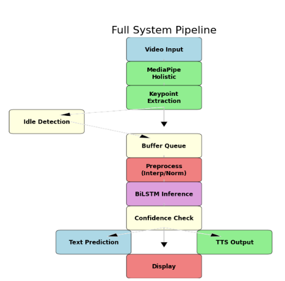
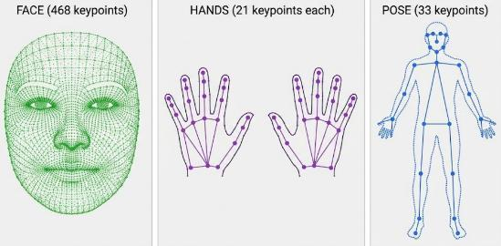
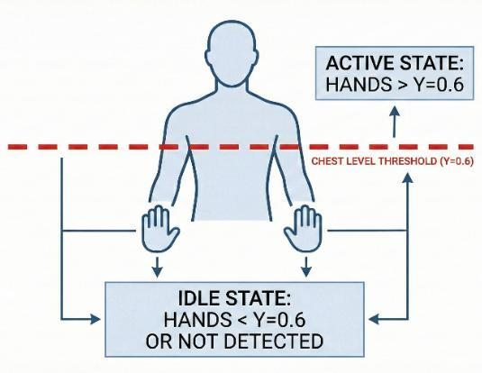
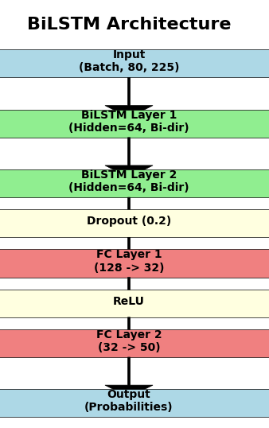
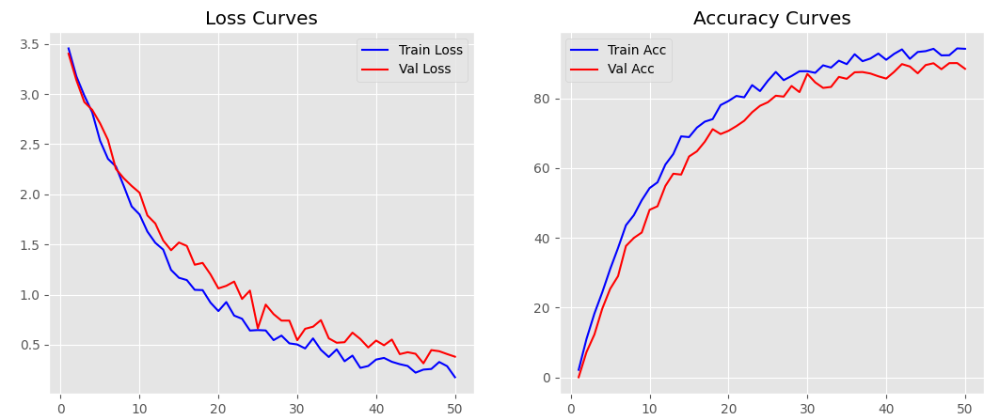
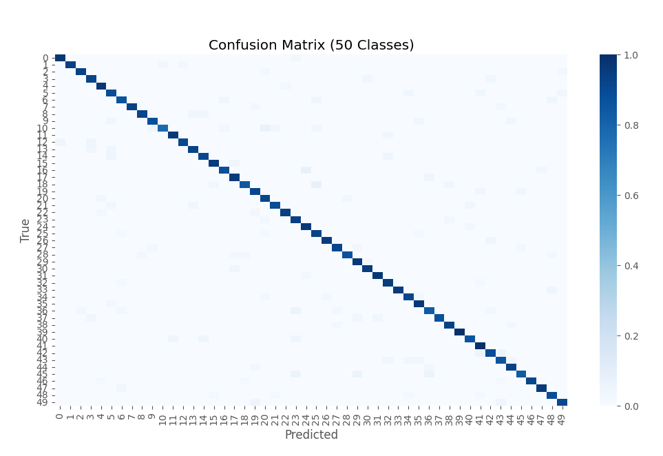
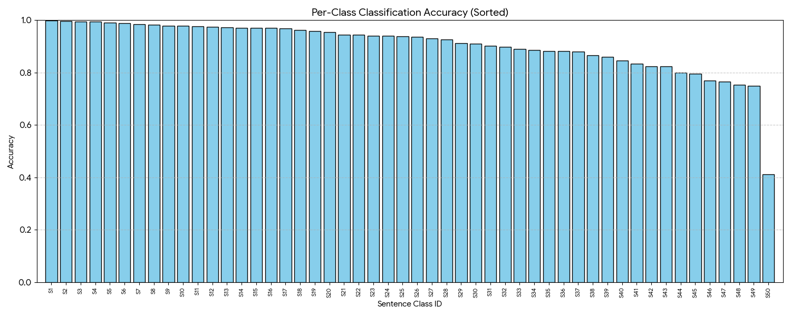
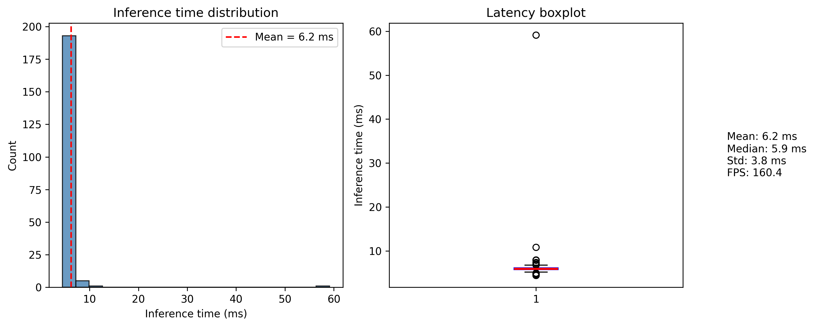
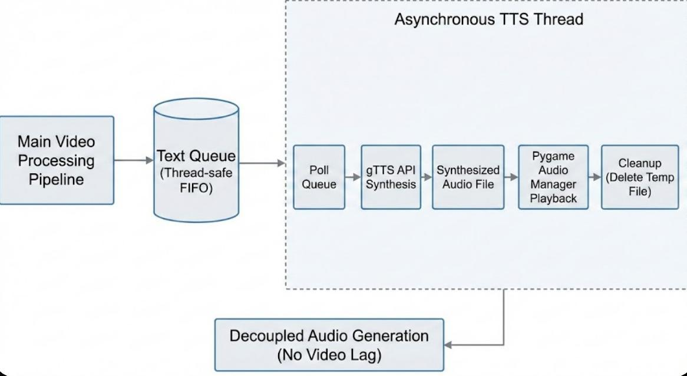
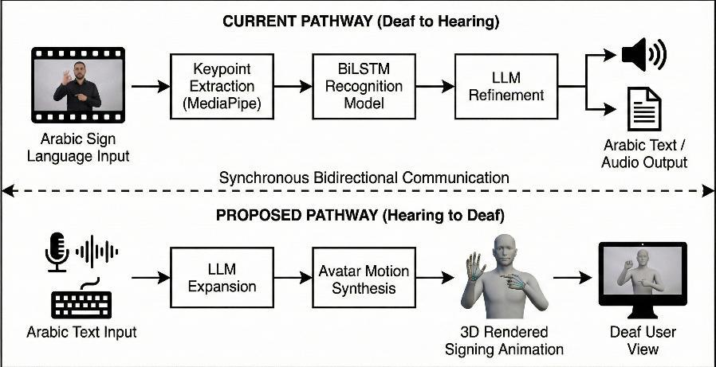

# Intelligent Real-Time Arabic Sign Language Translation

> **Senior Design Project (graduation project)** - B.Sc. Electrical Engineering, Islamic University of Madinah, 2025

A complete system that translates **continuous Arabic sign language video into natural spoken Arabic in real time**. It runs on a live webcam stream or on uploaded recordings, so Deaf and hearing people can communicate without an interpreter.

| | |
|---|---|
| **Accuracy** | **92.07 %** sentence accuracy on the ArabSign test set (50 sentence classes) |
| **Speed** | Real-time target of 26+ FPS, with a lightweight model of 254 k parameters |
| **Output** | Arabic text plus Arabic speech (LLM-refined and synthesised with TTS) |
| **Stack** | Python · MediaPipe Holistic · PyTorch BiLSTM · Flask/SocketIO · LLM API · gTTS |

## How it works

1. **Keypoint extraction.** MediaPipe Holistic tracks the pose (33 points) and both hands (21 points each) in every frame. This gives a 225-value feature vector per frame instead of raw pixels.
2. **Idle detection and segmentation.** A state machine watches where the hands are relative to chest level. Hands raised above the threshold means *signing*, and hands lowered means *idle*. Each idle-to-active-to-idle cycle is cut out as one sentence.
3. **Temporal normalisation.** Every sentence is linearly interpolated to **80 frames** and z-score normalised.
4. **BiLSTM classification.** Two bidirectional LSTM layers (64 units each way) feed dropout 0.2, then FC 128→32, then FC 32→50 and softmax.
5. **Confidence filter.** Predictions below **0.70** confidence are rejected. On the validation set this threshold gave precision 97.3 %, recall 96.2 % and F1 96.7 %.
6. **LLM refinement.** The raw sentence label is rewritten by a large language model into fluent, grammatical Arabic.
7. **Text-to-speech.** gTTS (Modern Standard Arabic) runs on a separate thread with a queue, so audio never blocks the video loop.

  
  

## Model and training

- Input `(batch, 80, 225)`; **254,098** trainable parameters (97.5 % in the BiLSTM layers)
- Adam optimiser (lr 0.001), batch size 32, ReduceLROnPlateau (×0.5, patience 5), early stopping
- Data split 70 / 15 / 15 on the **ArabSign** dataset

 

### Asynchronous speech output

## Documents
| | |
|---|---|
| 📄 [**Final report**](paper/Final_SDP2_Report.pdf) | 68 pages: literature review, the approaches considered (gloss translation vs. idle-based BiLSTM), design, training, evaluation and future work |
| 📄 [**LLM and TTS comparative study**](paper/LLM_and_TTS_Comparative_Analysis.pdf) | Compares 5 LLMs (Command R7B Arabic, Command R+, ALLaM 7B, DeepSeek V3, Llama 3.3 70B) and several TTS engines for Arabic sign-gloss correction |
| 🗂️ [`figures/`](figures/) | All diagrams and result plots |

## Future work: two-way translation

The next step is **gloss-level recognition** with sequence-to-sequence or Transformer models, which removes the fixed vocabulary of 50 sentences. Reverse translation (speech to a signing avatar) is also planned.

## Source code
The web application (Flask/SocketIO server, inference pipeline, LLM and TTS integration, trained weights) was built as a team and lives in the team repository:
**➡️ [github.com/MoBa02/ASLTranslator](https://github.com/MoBa02/ASLTranslator)**

## Acknowledgements
Trained and evaluated on the **ArabSign** dataset: H. Luqman, *ArabSign: A Multi-modality Dataset and Benchmark for Continuous Arabic Sign Language Recognition*, IEEE FG 2023. The dataset is not redistributed here.
